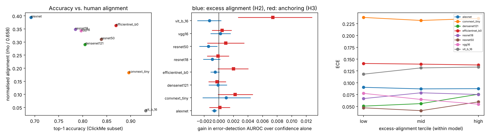

# Human alignment and confidence reliability

**Question.** Do image-level differences in how closely a network's evidence matches human diagnostic-feature maps (ClickMe) tell us whether its prediction is correct, beyond what its confidence already says?

**Short answer.** No. Across eight pretrained ImageNet networks and 1,500 ClickMe images, excess alignment adds nothing to confidence for flagging errors (all Holm p = 1.0). The known accuracy-versus-alignment trade-off reproduces (Spearman −0.74 over the eight models). A secondary measure of reliance on human-diagnostic regions shows a small, non-robust signal in the newest architectures. Read the short paper: [REPORT.md](REPORT.md).



## What is here
| File | Purpose |
|---|---|
| `PREREGISTRATION.md` | Hypotheses and tests, committed before any model was run |
| `THEORY.md` | The statistical question, a short proof of why it is the right test, and a glossary |
| `REPORT.md` | Two-page write-up with results, interpretation, limitations, references |
| `src/tfrec.py` | Dependency-free TFRecord reader for the ClickMe shards |
| `src/extract.py` | Predictions, evidence maps, alignment, shuffled-map null, deletion test |
| `src/analyze.py` | Pre-specified tests, figures, `results/summary.json` |
| `src/deletion_pred.py`, `src/analyze_post.py` | Post-hoc check H3b (see Deviations) |
| `results/` | Per-image outputs for every model, summary JSON, results table, figure |
| `tests/` | Unit tests for the statistics |

## Reproduce
```bash
pip install -r requirements.txt
# download the 17 ClickMe validation shards from the public bucket used by the original release
mkdir -p ~/data/clickme && cd ~/data/clickme
for i in $(seq 0 16); do curl -O https://storage.googleapis.com/serrelab/prj_harmonization/dataset/click-me/val/val-$i.tfrecords; done
cd -  # back to this folder; set CLICKME_DIR if you stored shards elsewhere
python src/extract.py --n 1500 --seed 0      # about 1 hour on 2 CPU cores
python src/analyze.py && python src/deletion_pred.py && python src/analyze_post.py && python src/make_tables.py
pytest -q tests
```

## Deviations from the plan
1. The pre-specified anchoring index (H3) uses the true-class probability. For wrong predictions that probability is already low, so the index has a floor effect that favours correct predictions. I added H3b, which measures the drop in the predicted class instead. H3b is post-hoc and reported next to H3, not instead of it.
2. Nothing else changed after the plan was committed.

## Limitations
Eight pretrained models, 1,500 images, one attribution method, ClickMe validation images only. Alignment requires a human map and the true label, so it is a research probe and not a deployable confidence score. See the report for the full list.

## Data and credit
Human importance maps: ClickMe (Linsley et al., 2019), accessed through the public files released with Fel et al. (2022). Pretrained weights: torchvision. The evidence-map and alignment protocol follow Fel et al. (2022).
