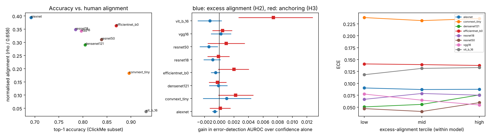

# Do networks that look where humans look know when they are wrong?

Orville Rockwell Jr. · Northeastern University · November 2026 · independent project, code and data in this folder

## Abstract
Deep networks that are more accurate on ImageNet tend to rely on image regions that differ more from the regions humans mark as diagnostic. A natural follow-up is whether the opposite holds for reliability: when a network's evidence matches human evidence, is its confidence more trustworthy? I tested this on 1,500 ClickMe images with eight pretrained networks. The known accuracy-alignment trade-off reproduced (Spearman −0.74 across models). But within a model, image-level alignment with human maps carried no information about whether the prediction was correct once confidence was accounted for (all eight Holm-corrected p = 1.0; cross-validated AUROC gains between −0.0014 and +0.0010). A secondary measure, how much the prediction depends on human-diagnostic regions, showed a small signal in the three most modern networks, but its effect sizes were tiny and I treat it as exploratory.

## 1. Background and question
Fel et al. (2022) found across 85 networks that higher ImageNet accuracy came with lower alignment between network and human feature-importance maps (ClickMe; Linsley et al., 2019), and proposed a training procedure ("harmonization") that improves both. Alignment is usually studied as a property of a *model*. Here it is studied as a property of an *image*: for each image, how closely does the model's evidence map match the human map, and does that predict reliability?

Formally, with C the model's confidence, Y whether the prediction is correct, and A the image-level alignment, the null hypothesis is that Y is independent of A given C (THEORY.md, Lemma 1, shows why this is exactly the statement that A adds no information to confidence).

## 2. Method (specified before running; see PREREGISTRATION.md)
- **Data.** A fixed random subset of 1,500 images from the ClickMe validation split (17,408 images), same images for every model.
- **Models.** AlexNet, VGG-16, ResNet-18, ResNet-50, DenseNet-121, EfficientNet-B0, ConvNeXt-Tiny, ViT-B/16 (torchvision pretrained weights).
- **Evidence maps.** Absolute gradient of the true-class logit, maximum over colour channels, as in the original alignment protocol. Human maps use the original preprocessing (resize to 64, Gaussian blur, resize to 224).
- **Alignment.** Spearman correlation with average ranks, normalised by the human ceiling 0.65753. *Excess* alignment subtracts the correlation with human maps of three other images, which removes the centre bias shared by ClickMe maps.
- **Test of H2.** Within-bin AUROC of excess alignment for correctness across ten confidence-quantile bins; 5,000 within-bin permutations; Holm correction over eight models. Effect size: change in 5×5-fold cross-validated AUROC when alignment is added to a logistic model of correctness on logit confidence, with a bootstrap interval.
- **Anchoring (H3).** Drop in the true-class probability when the top 20% of human-marked pixels are masked, minus the drop when the same area from a different image's map is masked.

## 3. Results

See `results/RESULTS.md` for the full table.

1. **Validity.** Every model aligns with human maps above the shuffled-map baseline (Wilcoxon p < 1e-6 for all eight), so the metric measures more than a shared centre bias. Across models, accuracy and normalised alignment are negatively related (Spearman −0.74, n = 8): ViT-B/16 is the most accurate (93.1%) and least aligned (0.04 of the human ceiling); AlexNet is the least accurate (69.2%) and most aligned (0.39).
2. **H1, model level (descriptive).** Alignment and ECE are unrelated across models (Spearman −0.05, −0.07 after residualising on accuracy). With eight models this cannot rule out a modest relationship.
3. **H2 (confirmatory): a null.** Excess alignment does not predict correctness beyond confidence in any model. Within-bin AUROCs lie between 0.467 and 0.520, all Holm-adjusted p = 1.00. Cross-validated AUROC gains range from −0.0014 to +0.0010 (the only intervals excluding zero are slightly negative). ECE does not change systematically across alignment terciles.
4. **H3 (secondary), with a correction.** The pre-specified anchoring index gave within-bin AUROC above 0.5 for ConvNeXt-Tiny, EfficientNet-B0 and ViT-B/16 (Holm p = 0.015, 0.028, 0.005). I then noticed a floor effect: for wrong predictions the true-class probability is already low, so the index cannot be large. I therefore added a post-hoc variant (H3b) that measures the drop in the predicted class. There, only ConvNeXt-Tiny stays below Holm 0.05 (0.043); EfficientNet-B0 and ViT-B/16 land at 0.062 and 0.057. Cross-validated AUROC gains are at most +0.007, and no positive gain has an interval that excludes zero. This is suggestive for the newer architectures, not established.

## 4. Interpretation
Looking where humans look, at the level of single images, does not make a network's confidence more trustworthy than the confidence already is. A plausible reading is that confidence is already a sufficient summary of how much evidence the network found, so a map-level similarity adds nothing about that. This does not say alignment is unimportant; it says it is not a free reliability signal for pretrained models. The weak signal for the newer models raises a more specific question I cannot answer here: whether reliance on human-diagnostic regions matters more for models trained with different objectives or data, which would need models trained for that purpose.

Two details matter for reading ECE. ConvNeXt-Tiny and ViT-B/16 are under-confident (mean confidence 0.66 and 0.81 versus accuracy 0.90 and 0.93), which probably reflects their torchvision training recipes (label smoothing and mixup-style augmentation; I did not verify this here), so their ECE is high without being over-confident.

## 5. Limitations
- 1,500 images, eight pretrained models, one saliency method (gradient magnitude). Results may differ for other attribution methods; I did not test that.
- Alignment needs a human map and the true label, so it is a diagnostic probe, not a deployable confidence score.
- Conditional independence given C implies independence given the bin only if alignment does not vary with C inside a bin (THEORY.md). The logistic effect size is a second check, and the two largely agree on the null.
- H1 uses eight points. H3b is post-hoc.
- ClickMe validation images are easier than the full ImageNet validation set (these models score above their published top-1 here), leaving fewer errors to analyse (103 for ViT-B/16, 462 for AlexNet).

## References
- Fel, T., Felipe, I., Linsley, D., & Serre, T. (2022). Harmonizing the object recognition strategies of deep neural networks with humans. NeurIPS 35. arXiv:2211.04533.
- Linsley, D., Shiebler, D., Eberhardt, S., & Serre, T. (2019). Learning what and where to attend. ICLR. arXiv:1805.08819.
- Guo, C., Pleiss, G., Sun, Y., & Weinberger, K. Q. (2017). On calibration of modern neural networks. ICML.
- Murphy, A. H. (1973). A new vector partition of the probability score. Journal of Applied Meteorology, 12, 595–600.
- Holm, S. (1979). A simple sequentially rejective multiple test procedure. Scandinavian Journal of Statistics, 6, 65–70.
